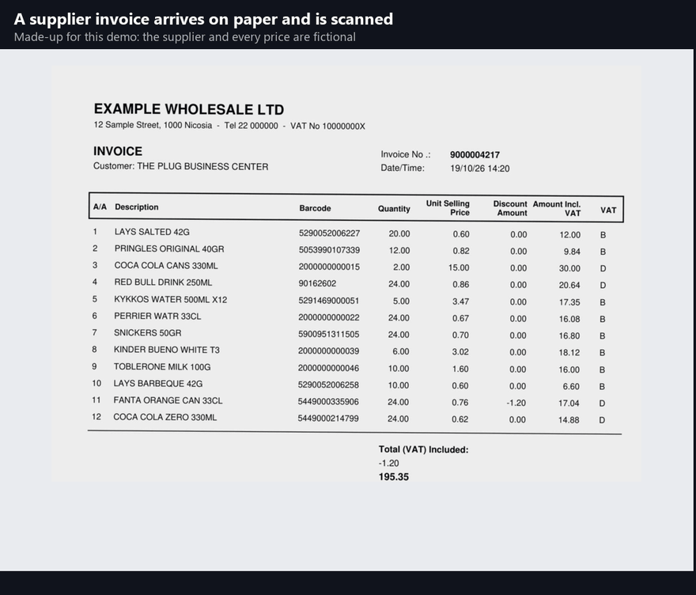

# Invoice Automation

Turns scanned supplier invoices into stock-upload files for **The Plug**, a 24/7 print shop and mini-market in Nicosia, Cyprus. Azure AI reads each invoice. The tool matches every line to the shop's own items, converts cases and packs into selling pieces, and checks every number. Staff answer a few yes/no questions instead of typing the invoice in. **In use at the shop.**



<sub>The invoice in the recording is made up for this demo: the supplier and every price are fictional. [Video (MP4)](docs/demo/demo.mp4) · [the invoice (PDF)](docs/demo/example-invoice.pdf)</sub>

---

## The problem

Stock arrives with paper invoices from about 20 suppliers. To get it into the shop's stock system (PowerSoft), a staff member opened that supplier's Excel sheet, searched for each item, typed the quantity, deleted every empty row and uploaded the file. A wholesaler invoice has 40 to 60 lines. Every new product meant typing its name, barcode, category and cost by hand. Cases had to be converted to pieces by hand (2 cases of 24 cans = 48), and costs were rarely updated because checking them took even longer.

**Estimate:** roughly 8 to 10 invoices a week, at 10 to 40 minutes each, is **about 2 to 3 hours of typing a week**. With the tool, staff answer the questions it can't settle alone: about 2 minutes for an invoice with 12 questions, and fewer each time, because every answer is remembered. That's **well under half an hour a week**. The tool logs the time spent on every invoice, so these estimates will be replaced with measured numbers.

## How it works

```
input/  scanned PDFs
   │
   ├─ split into pages, recognise the supplier, join multi-page invoices
   ├─ Azure AI Document Intelligence (prebuilt-layout): every table cell, with a confidence score (cached)
   ├─ supplier profile: which column is what, VAT rules, units -> selling pieces
   ├─ match each line: learned answer → barcode → exact name → similar name
   ├─ check: every line's sum, the invoice total, pack sizes against known costs
   ├─ review window: staff answer what the tool isn't sure of, from the paper and the shelf
   └─ once every question is answered: the PowerSoft import file, and everything learned is saved
   │
output/Ready to upload/  → staff upload it to PowerSoft
```

**Flag, don't guess.** Nothing uncertain reaches the stock system. A near match ("PERRIER WATR" vs "PERRIER WATER") is shown with the differing words in red and confirmed by staff. A line whose numbers don't add up is checked against the paper. The Excel is only written once every question on the invoice is answered.

**Cases and packs, by price.** Suppliers sell by the case; the shop sells by the piece. When an invoice line doesn't say how many pieces a unit holds, the tool divides its price by the known cost of one piece. If 24.7 times one can, it suggests 24 and asks staff to confirm. A learned pack size is re-checked by price on every invoice, so a supplier switching from 24-packs to 12-packs is caught. Pack items the shop sells separately (a 12-pack of water that takes 12 bottles off stock) are linked to their single bottle by name, and go in as 12 bottles without a question.

**It learns.** Every answer is saved per supplier: the barcode a wholesaler uses for a case, its pack size, their wording for a product. The next invoice from that supplier asks less: once staff confirm a supplier's wording for a product, it isn't asked again.

**New products.** The new-item form takes the cost from the invoice, never from typing, and refuses a selling price below cost. When one unit holds several pieces, it first offers the single item the shop already sells, so a 3-pack of something stocked doesn't become a duplicate item.

### Why Azure Document Intelligence, not a vision LLM

The invoices are printed tables, and the tool needs every cell exactly, with a way to tell how sure the reading is. Document Intelligence's `prebuilt-layout` model returns the table structure, each cell's text and a confidence score per word. It is billed per page, and the free tier (500 pages a month) covers the shop. Each supplier's quirks (VAT included or not, a pack-size column, a discount column) live in a small profile, about 70 lines per supplier, instead of in a prompt. Wrong readings are caught by arithmetic, not by trusting a model. Responses are cached, so a scan is never paid for twice. The comparison is in [DECISIONS.md](DECISIONS.md) (D-003, D-021).

## Built for a real shop PC

The tool runs on the shop's Windows PC, which resets its C: drive at every restart (Deep Freeze), and is maintained remotely.

- **Code and data are separate folders.** An update replaces only the code: one click downloads the newest version from this repository, checks that it starts against the real data, and goes back to the previous version on its own if it doesn't. What the tool has learned is never touched.
- **Nothing learned can be lost to a crash.** Every file is saved to a temporary copy and swapped in with one rename, and the first run each day makes a backup (30 days kept).
- **Bad input is refused, not used.** A cut-off item export, or one missing a column, is skipped for the previous one. If the learned table goes missing, the tool stops and asks for the owner rather than quietly starting from scratch.
- **Staff-friendly.** Big buttons, short words, the line from the scan shown above every question, "< Previous question" for mis-clicks, "I'm not sure" to pass an invoice to the owner, and "Not for the shop" for something bought on the shop's invoice for elsewhere. Staff see one folder: where scans go, what to upload, the button and the guide; the rest is tucked away. Errors read "contact Zein"; details go to a log.

## How it was built

I designed this project and made its decisions: what to automate and what to leave to staff, the matching order, how packs are detected, what gets asked and what doesn't. The code was written with [Claude Code](https://claude.com/claude-code), one reviewed step at a time. Every significant choice and its reasoning is in **[DECISIONS.md](DECISIONS.md)**: 26 decisions, from dropping an LLM step to the deployment design. The tool was tested on real invoices from every supplier it handles, including two rehearsals with real invoices before going live.

## Repository layout

```
├── DECISIONS.md               every design decision and its reasoning
├── src/invoice_automation/
│   ├── extract.py             Azure Document Intelligence calls, cached
│   ├── layout.py              tables, numbers and barcodes from the layout result
│   ├── suppliers/             one small profile per supplier, on a shared base
│   ├── catalogue.py           the PowerSoft item export, pack links
│   ├── supplier_items.py      what the tool has learned, per supplier
│   ├── matching.py            matching and pack sizes
│   ├── pipeline.py            queue, questions, and the finished Excel
│   ├── session.py, ui.py      the review window
│   └── files.py, backup.py    crash-safe saving, daily backups
├── tests/                     unit tests on made-up data
├── deploy/                    shop PC launchers, first install, update and undo, staff and admin guides
├── scripts/                   the demo invoice and recording, early experiments
└── docs/demo/                 the made-up invoice and the recording
```

## Running it

Needs Windows, Python 3.12, [uv](https://docs.astral.sh/uv/) and an Azure Document Intelligence resource (the free F0 tier is enough).

```powershell
uv sync
copy .env.example .env   # then fill in AZURE_DI_ENDPOINT and AZURE_DI_KEY
uv run pytest            # unit tests, no Azure needed

uv run invoice-automation                  # process everything in input/ and open the review window
uv run invoice-automation path\to\scan.pdf # process specific files, leaving them where they are
uv run invoice-automation --zein           # the owner's mode: also invoices staff passed on
uv run invoice-automation --no-window      # no window: finish what needs no questions (testing)
uv run invoice-automation --packs          # which single item each pack item counts as
```

The tool needs the shop's PowerSoft item export (`data/powersoft/itemsList.csv`), so it won't match items without the shop's data. The shop PC install is [`deploy/setup.ps1`](deploy/setup.ps1); day-to-day running is in the [staff guide](deploy/guides/Staff%20guide.html) and the [admin guide](deploy/guides/Admin%20guide.html).

**For shop staff:** put the scans in `1. Put invoice scans here`, double-click **Process Invoices**, answer the questions from the paper invoice and the product, then follow the Done screen: Items import for the files it lists, Purchase order for every file in `2. Excel files ready to upload`, then tick them and press **Mark as uploaded** so nothing goes in twice.

## Data and privacy

Real invoices, supplier price lists and the shop's item data stay on the shop PC and Zein's computer, and are never committed (`data/` is git-ignored). The demo invoice is made up: the supplier and every price on it are fictional, and its new barcodes use the in-store range (200…), which no real product carries. The unit tests use made-up items only.
